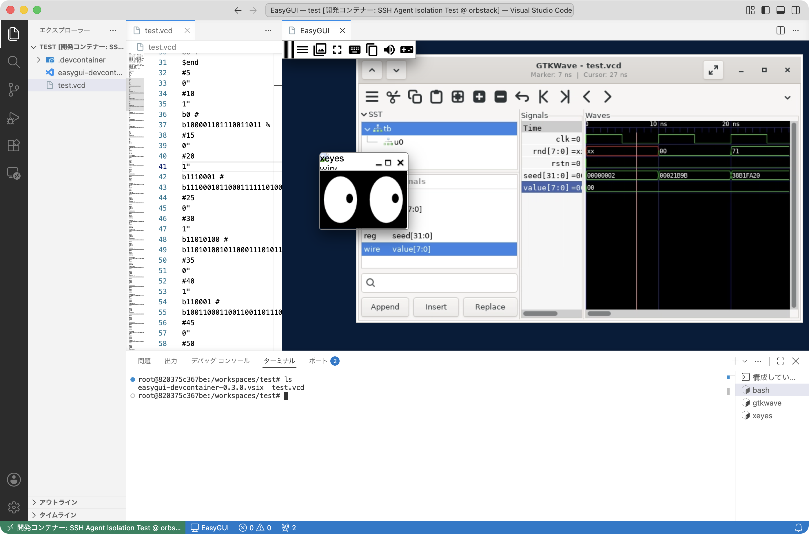

# EasyGUI for DevContainer


[VSCode Marketplace](https://marketplace.visualstudio.com/items?itemName=PepperCat.easygui-devcontainer)

Shows Linux GUI (X11) applications running in a Dev Container in a VS Code editor tab.

No Dockerfile or devcontainer.json changes, no root, nothing installed on the host. On first use the extension downloads a self-contained Xpra runtime (about 35 MB) from [xpra-runtime](https://github.com/PepperCat-YamanekoVillage/xpra-runtime) into its own storage.

## Requirements

- A Linux container with glibc 2.36 or newer (Debian 12+, Ubuntu 24.04+, Fedora, Arch, ...), x64 or arm64
- `tar` in the container
- Access to github.com on first use

## Usage

1. Install the VSIX while VS Code is connected to the container (Extensions: Install from VSIX...).
2. Accept the runtime download. The status bar shows `🖥 EasyGUI` when ready.
3. In a terminal opened after that, start an application (e.g. `xterm &`). Click `🖥 EasyGUI` to open the display tab.

Terminals opened before the extension started have no `DISPLAY`; open a new one.

## Commands

| Command | |
| --- | --- |
| EasyGUI: Start / Show Display | Start the display server and open the tab |
| EasyGUI: Stop | Stop the display server (applications on it exit) |
| EasyGUI: Restart Backend | Restart the display server |
| EasyGUI: Show Logs | Show the extension and server logs |

## Settings

| Setting | Default | |
| --- | --- | --- |
| `easyGui.autoStart` | `true` | Start the display server when the window opens |
| `easyGui.installRuntime` | `ask` | Download the runtime: `ask`, `always` or `never` |
| `easyGui.displayNumber` | `0` | X display number (`0`: first free from `:100`) |
| `easyGui.dpi` | `96` | DPI reported to applications |
| `easyGui.terminalEnvironment` | `true` | Set `DISPLAY` / `XAUTHORITY` in new terminals |

## Limitations

- All windows are shown in one tab.
- No OpenGL, sound, printing or file transfer.
- Committed IME text (e.g. Japanese input) does not reach applications.
- Some shortcuts (Ctrl+P, Ctrl+W, ...) are taken by VS Code.

## Development

```sh
npm install
npm run package                                     # builds easygui-devcontainer-<version>.vsix
npm test                                            # activation test
CHROMIUM=/path/to/chrome npm run test:integration   # end-to-end test (runs xpra)
make clear                                          # removes node_modules, dist and *.vsix
```

## License

MIT. The downloaded runtime is not part of this extension; its components keep their own licenses (Xpra: GPL-2.0-or-later, xpra-html5: MPL-2.0, Debian packages: see `usr/share/doc/*/copyright` in the runtime).
